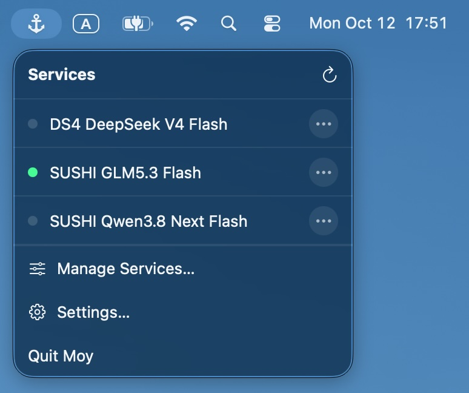

# Moy

**A safe harbor for your local services.**

Moyは、CLIサービスをユーザー単位のLaunchAgentとして登録・管理するmacOS用メニューバーアプリです。登録したサービスは、メニューバーと同梱の`moy` CLIから操作できます。

[English](README.md)



## 動作環境

- macOS 26以降（Apple Siliconのみ）。
- Xcode 27 / Swift 6.4
- mise

## ビルド方法

次のコマンドでビルドし、アプリを起動できます。

```bash
mise install
mise run generate
mise run build
open build/Build/Products/Debug/Moy.app
```

## 主な機能

- サービスの登録・編集・有効化・無効化・再起動。
- メニューバーから状態確認と標準出力・標準エラーログへのアクセス。
- GUIとCLIでサービス定義を共有。スクリプト向けのJSON出力にも対応。

- 管理対象はMoyで登録したユーザー単位のLaunchAgentです。
- Moyを終了しても、`launchd`によるサービス管理は続きます。

## 使い方

`Moy.app`を開き、メニューバーから操作します。

1. メニューバーの「サービスを管理」からサービスを追加します。
2. 一意のIdentifierと実行ファイルの絶対パスを入力し、引数や環境変数を設定します。
3. 定義を保存するか、「保存して有効化」でそのまま有効にします。

各操作は、次のように動作します。

| 操作 | 動作 |
| --- | --- |
| 有効化 | LaunchAgentのplistを作成し、`launchd`に登録。 |
| 無効化 | サービスを停止・登録解除し、plistを削除。定義とログは保持。 |
| 再起動 | 待機中なら起動、実行中なら再起動。有効で読み込み済みのサービスが対象。 |
| 削除 | サービスを無効化し、定義を削除。ログは保持。 |

- 有効なサービスは次回ログイン時にも読み込まれます。
- 自動起動は`RunAtLoad`と`KeepAlive`の設定に従います。

### サービス設定

以下のLaunchAgent設定に対応しています。

| 設定 | 用途 |
| --- | --- |
| `Label` | `com.sputnik-apps.moy.<Identifier>`として自動生成。Identifierは作成後の変更不可。 |
| `ProgramArguments` | 実行ファイルの絶対パスと、順序付きの引数。 |
| `WorkingDirectory` | 作業ディレクトリ。任意指定。 |
| `EnvironmentVariables` | プロセスに渡す環境変数。 |
| `RunAtLoad` | LaunchAgentの読み込み時に起動。初期値はOFF。 |
| `KeepAlive` | サービスを起動し、実行状態を維持。初期値はOFF。 |
| `ThrottleInterval` | 起動間隔の最小秒数。未指定時はOSの既定値。 |
| `StandardOutPath` / `StandardErrorPath` | ログ保存先。未指定時はMoyの既定ログディレクトリ。 |

- Identifierは1〜64文字のASCII小文字英数字・ハイフン・アンダースコアで、先頭と末尾は英数字にします。
- 実行ファイルは絶対パスで指定してください。
- シェルの設定は読み込みません。必要な環境変数や`PATH`は明示的に設定してください。
- GUIでは1行が1つの引数です。引用符や`$VARIABLE`はそのまま渡されます。
- シェルの処理が必要な場合は、`/bin/zsh`などにスクリプトを引数として渡してください。
- `ThrottleInterval`は起動頻度を制限する設定で、定期実行の間隔ではありません。

### CLI

#### インストール・アンインストール

- 「設定… → コマンドラインツール」から、同梱CLIへのシンボリックリンクを`/usr/local/bin/moy`に作成・削除できます。
- 必要な場合のみmacOSの管理者認証を求めます。
- 既存ファイルや別のリンクは上書きしません。
- アンインストールで削除されるのはリンクだけです。サービス・設定・ログは残ります。

#### 使用例

次の例では、Webサーバーを登録し、状態確認や再起動を行います。

```bash
moy --help

# 定義を保存してから有効化する
moy add --identifier web-server \
  --name "Local web server" \
  --program /usr/bin/python3 \
  --arg -m --arg http.server --arg 8080 \
  --working-directory "$PWD" \
  --run-at-load

moy enable web-server
moy status web-server
moy restart web-server
moy logs web-server
moy disable web-server
```

#### サブコマンド一覧

以下のサブコマンドを利用できます。

| コマンド | 動作 |
| --- | --- |
| `list` | 登録済みサービスの一覧を表示。 |
| `show` | サービスの定義を表示。 |
| `add` | サービスの定義を追加。 |
| `edit` | サービスの設定を変更。 |
| `remove` | サービスを無効化し、定義を削除。 |
| `enable` | plistを作成し、サービスを有効化。 |
| `disable` | サービスを停止・登録解除し、plistを削除。 |
| `restart` | 待機中なら起動、実行中なら再起動。 |
| `status` | サービスの状態を表示。 |
| `logs` | 標準出力・標準エラーログのファイルパスを表示。 |

- サービスの指定にはIdentifierを使います。
- `add --enable`で保存と有効化を一度に行えます。
- `status`はIdentifierを省略すると全件を表示します。
- `list`・`show`・`status`・`logs`は`--json`でJSON出力に対応しています。
- 各コマンドの詳細は`moy <command> --help`で確認できます。

## ライセンス

[MIT](LICENSE) © 2026 Yoshihiro Kato
